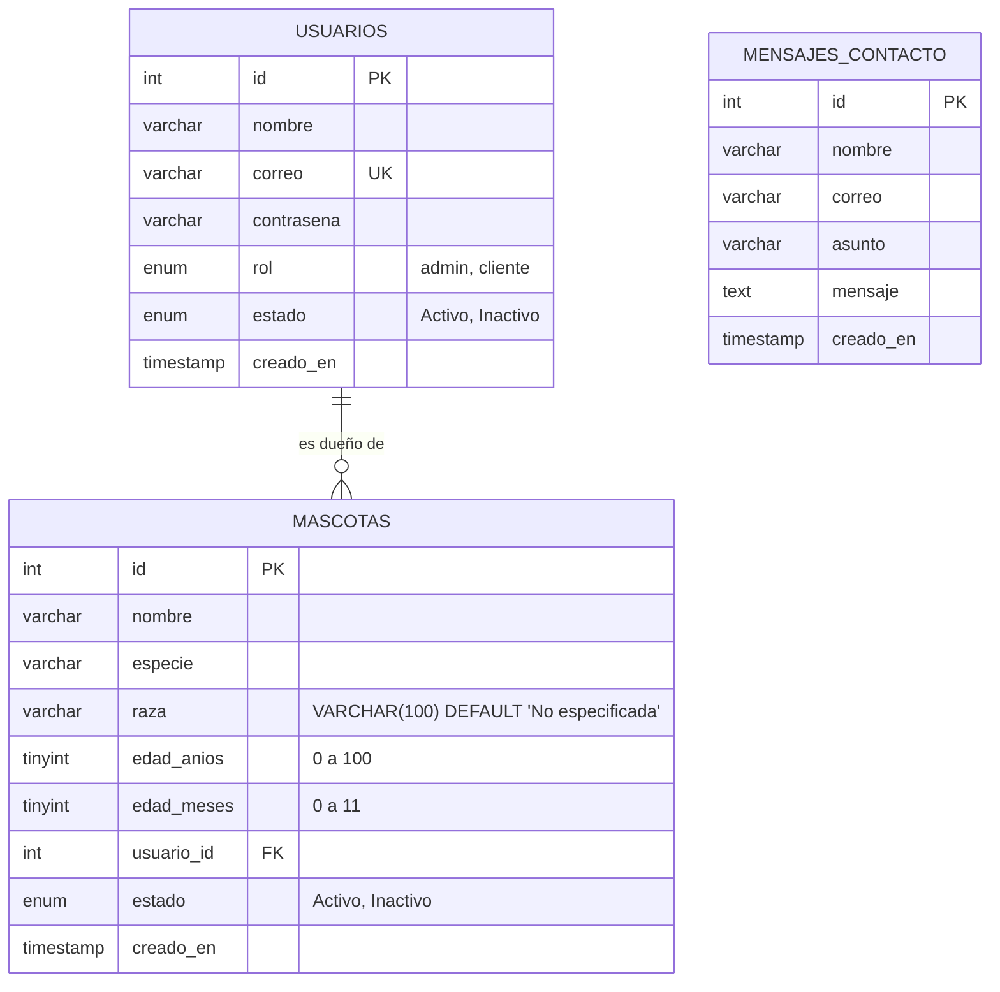

# Documentación del proyecto: Cuidado de tus Mascotas

Actualizada: 28 de octubre de 2026. Documento de trabajo para preparar la entrega final.

## 1. Descripción y propósito
Sistema web académico de registro de mascotas atendidas en una veterinaria. El administrador gestionará los registros y cada cliente consultará únicamente sus propias mascotas. Las pantallas actuales usan datos ficticios y todavía no aplican esos permisos.

## 2. Alcance acordado
Campos centrales de la mascota: nombre, especie, edad positiva y dueño. El administrador tendrá operaciones de crear, consultar, modificar y eliminar. El cliente tendrá consulta de sus mascotas. Se requiere filtro por especie y validaciones en navegador y servidor.

La página pública presenta servicios, misión, visión y objetivos. Registro de cuenta, perfil y recuperación son pantallas añadidas durante el desarrollo. La funcionalidad de citas y el video se propusieron, pero no se han implementado.

## 3. Tecnologías y responsabilidades
| Tecnología | Responsabilidad |
|---|---|
| HTML | Estructura, campos, tablas, enlaces y contenido |
| CSS | Colores, fondos, tamaños, menú sticky, animaciones y adaptación a pantallas |
| JavaScript | Huellas, filtros, búsqueda y validaciones visuales |
| PHP | Actualmente sirve páginas y genera versiones de CSS con filemtime; posteriormente validará sesiones, permisos y datos y ejecutará consultas |
| MySQL | Almacenamiento futuro; todavía no se ha creado ni conectado en este trabajo |
| XAMPP | Apache y entorno local de ejecución de PHP |

Las páginas con extensión PHP todavía contienen principalmente HTML. Tener la extensión no significa que los formularios ya procesen información.

## 4. Ubicación y ejecución
Ruta: `C:\xampp\htdocs\Proyecto-final\registro-mascotas`.

1. Abrir XAMPP e iniciar Apache.
2. Entrar a `http://localhost/Proyecto-final/registro-mascotas/index.php`.
3. Utilizar los enlaces de navegación pública.
4. Para probar paneles, abrir sus direcciones directamente. No existe todavía redirección de login por rol.
5. Si Apache usa otro puerto, añadirlo después de localhost.

No es necesario iniciar MySQL para las pantallas actuales. Usar datos ficticios en los formularios de práctica.

## 5. Pantallas
| Archivo | Contenido y estado |
|---|---|
| `index.php` | Presentación, servicios, accesos, información institucional y pie |
| `login.php` | Inicio de sesión visual; no autentica |
| `registro.php` | Alta pública visual; no guarda usuarios |
| `recuperar-contrasena.php` | Solicitud visual por correo; no envía mensajes |
| `cambiar-contrasena.php` | Cambio desde perfil con validación de práctica; no guarda |
| `cliente/panel.php` | Bienvenida e indicadores de ejemplo |
| `cliente/mis-mascotas.php` | Tarjetas con filtro por especie |
| `cliente/perfil.php` | Consulta de datos ficticios y enlace de cambio de contraseña |
| `admin/panel.php` | Resumen administrativo y accesos |
| `admin/mascotas.php` | Tabla y filtro; edición/eliminación pendientes |
| `admin/clientes.php` | Tabla y búsqueda por nombre o correo |
| `admin/formulario-cliente.php` | Formulario con validación, sin guardado |
| `admin/formulario-mascota.php` | Archivo reservado; todavía no contiene el formulario |

Datos actuales: Laura Pérez, Max y Luna. Los nombres, cantidades y asociaciones están escritos en HTML.

## 6. Organización de carpetas
- `admin`: pantallas de administración.
- `cliente`: pantallas de consulta del cliente.
- `assets/css`: estilos compartidos y por pantalla, todos con comentarios de sección.
- `assets/js`: comportamiento de filtros, validaciones y animaciones.
- `assets/img`: siete imágenes del inicio público.
- `includes`: archivos reservados para componentes compartidos; aún no se usan.
- `db`: contiene `import.sql` vacío; no existe implementación de base de datos.
- `docs`: bitácora, manual, resumen de avance y guía de estilos.

Consultar `organizacion-estilos.md` para la correspondencia entre CSS y páginas. Los estilos comunes se cargan primero y los específicos después. Las rutas de imágenes dentro del CSS parten de `assets/css`, por eso usan `../img/`.

## 7. JavaScript existente
| Archivo | Función |
|---|---|
| `principal.js` | Dibuja recorridos de huellas y elimina cada huella al terminar su animación |
| `mascotas.js` | Filtra las tarjetas del cliente por especie y actualiza el contador |
| `admin-mascotas.js` | Filtra filas de la tabla administrativa por especie |
| `admin-clientes.js` | Busca nombre o correo sin distinguir mayúsculas ni acentos |
| `formulario-cliente.js` | Rechaza nombres vacíos y contraseñas diferentes; informa que no hay guardado |
| `cambiar-contrasena.js` | Muestra/oculta claves, compara confirmación y evita repetir la clave actual escrita |

Los scripts se conectan con `defer` para esperar a que exista el HTML. Los filtros actuales solo recorren datos ya cargados; podrán conservarse cuando PHP genere las filas desde MySQL. Si se incorpora paginación, habrá que decidir cómo buscar en todos los registros.

## 8. Diseño y decisiones
- Paleta azul y morada, tarjeta de acceso translúcida y ondas SVG.
- Huellas animadas detrás del formulario, sin bloquear clics.
- Tarjeta de acceso reducida por preferencia del estudiante.
- Se retiraron las orejas decorativas de los títulos; se conservó la cola.
- Menú lateral sticky en escritorio y menú superior en celulares.
- La página activa se marca con HTML y CSS; no requiere JavaScript.
- Versiones automáticas de CSS mediante filemtime para reducir problemas de caché.
- Diferenciación de especie y raza en las mascotas de ejemplo.

## 9. Imágenes del inicio
| Archivo en assets/img | Ubicación |
|---|---|
| `su cuidado.jpeg` | Presentación principal |
| `mis mascotas.jpeg` | Tarjeta Mis mascotas |
| `unete a nuestra comunidad.jpeg` | Tarjeta Únete a nuestra comunidad |
| `area del personal.jpeg` | Tarjeta Área del personal |
| `consulta veterinaria.jpeg` | Tarjeta Consulta veterinaria |
| `atencion preventiva.jpeg` | Tarjeta Atención preventiva |
| `registro de mascotas.jpeg` | Tarjeta Registro de mascotas |

## 10. Verificaciones realizadas
Según el registro de la revisión del 27 de octubre:
- 18 archivos PHP y 6 JavaScript sin errores de sintaxis.
- 12 páginas revisadas, con referencias locales y etiquetas comprobadas.
- 11 CSS cargados en el navegador.
- Búsqueda de clientes con y sin resultados y filtros de especies del cliente y administrador probados.
- Siete comprobaciones de validación de clientes y cambio de contraseña con datos ficticios.

Esta actualización documental del 28 de octubre no añade nuevas pruebas funcionales. Las cifras describen el alcance de la revisión anterior, no una certificación de que el sistema esté terminado.

## 11. Pendientes técnicos
Faltan MySQL y su modelo ER, conexión PDO, consultas preparadas, password_hash/password_verify, validación del servidor, sesiones y permisos, CRUD persistente, edición del perfil y recuperación real por enlace temporal. La validación de una contraseña escrita no verifica la identidad del usuario.

El plan detallado y la siguiente tarea se mantienen en `estado-proyecto.md`. El desarrollo de MySQL comenzará cuando el estudiante lo indique.

## 12. Documentación de entrega pendiente
Completar portada e integrantes, diagrama y explicación ER, capturas finales, instrucciones de importación de SQL, pruebas de instalación desde cero y conclusiones. Convertir el contenido final a Word o PDF según lo solicitado en la guía del profesor.

---

## Actualización técnica del 9 de noviembre de 2026: Persistencia PDO, Seguridad, Borrado Lógico, Sesiones por Rol y Campo Raza

En la jornada del 9 de noviembre de 2026 se completó la implementación del backend en PHP 8.2 y MySQL (InnoDB), conectando todas las vistas mediante PDO y consultas preparadas.

### 13. Modelo de Base de Datos y Diagrama Entidad-Relación (`db/import.sql`)

La base de datos `registro_mascotas` (`utf8mb4_unicode_ci`) está compuesta por tres tablas relacionales definidas en `db/import.sql`:



- **`usuarios`:** Almacena tanto administradores (`rol = 'admin'`) como clientes (`rol = 'cliente'`). El correo electrónico tiene índice `UNIQUE` y la contraseña se almacena cifrada con `password_hash(..., PASSWORD_DEFAULT)`.
- **`mascotas`:** Se relaciona con `usuarios(id)` mediante la clave foránea `fk_mascotas_usuario` (`ON DELETE CASCADE ON UPDATE CASCADE`). Incluye `raza VARCHAR(100) NOT NULL DEFAULT 'No especificada'`, `edad_anios TINYINT UNSIGNED` y `edad_meses TINYINT UNSIGNED`.
- **`mensajes_contacto`:** Registra las consultas enviadas desde el formulario público `contacto.php`.

### 14. Persistencia con PDO y Aislamiento de Credenciales

- **Aislamiento de credenciales (`includes/config.php` y `.gitignore`):**
  - Las constantes `DB_HOST`, `DB_NAME`, `DB_USER`, `DB_PASS` y `DB_CHARSET` residen en `includes/config.php` protegidas con guardias `defined(...) || define(...)`.
  - El archivo `includes/config.php` está listado en `.gitignore` para evitar exponer credenciales en repositorios públicos.
- **Conexión segura (`includes/conexion.php`):**
  - Instancia `$pdo` con `PDO::ATTR_ERRMODE => PDO::ERRMODE_EXCEPTION`, `PDO::ATTR_DEFAULT_FETCH_MODE => PDO::FETCH_ASSOC` y `PDO::ATTR_EMULATE_PREPARES => false` (consultas preparadas nativas en MySQL).
  - En caso de fallo de conexión, captura `PDOException`, registra el detalle técnico con `error_log()` sin exponer trazas ni contraseñas en pantalla y define `$errorConexion` para que la interfaz muestre un aviso controlado.
- **Consultas preparadas y relaciones SQL:**
  - Todas las lecturas y escrituras con datos externos emplean `$pdo->prepare()` y marcadores con nombre (`:nombre`, `:especie`, `:raza`, `:edad_anios`, `:edad_meses`, `:usuario_id`, `:id`).
  - `admin/mascotas.php` y `admin/panel.php` utilizan `INNER JOIN` entre `mascotas` y `usuarios` para obtener el nombre del dueño junto a los datos de cada mascota activa.
  - `admin/clientes.php` emplea `LEFT JOIN` con `COUNT(mascotas.id)` y `GROUP BY` para calcular en una sola consulta cuántas mascotas activas tiene cada cliente.

### 15. Borrado Lógico (Soft Delete) e Integridad de Operaciones

- **Columna `estado`:** Tanto `usuarios` como `mascotas` cuentan con `estado ENUM('Activo', 'Inactivo') NOT NULL DEFAULT 'Activo'`.
- **Baja sin pérdida de historial:** Al eliminar una mascota desde `admin/mascotas.php` (mediante petición `POST`), no se ejecuta `DELETE FROM`, sino:
  ```sql
  UPDATE mascotas SET estado = 'Inactivo' WHERE id = :id AND estado = 'Activo'
  ```
  Se comprueba `$stmtEliminar->rowCount() > 0` antes de confirmar la baja con `?eliminado=1`.
- **Filtrado consistente y validación previa en edición:**
  - Todos los listados (`admin/mascotas.php`, `admin/clientes.php`, `admin/panel.php`, `cliente/panel.php`, `cliente/mis-mascotas.php`) y el selector de clientes en `admin/formulario-mascota.php` filtran por `estado = 'Activo'`.
  - Antes de procesar un `UPDATE` en `admin/formulario-mascota.php` o `admin/formulario-cliente.php`, el servidor verifica mediante una consulta previa que el ID recibido exista y tenga `estado = 'Activo'`, impidiendo ediciones sobre registros dados de baja o inexistentes.

### 16. Autenticación y Sesiones Estrictas por Rol

- **Inicio de sesión (`login.php`) y Registro (`registro.php`):**
  - `login.php` consulta el usuario activo por correo, valida la clave con `password_verify()`, regenera el identificador de sesión con `session_regenerate_id(true)` para prevenir fijación de sesión y almacena `usuario_id`, `usuario_nombre`, `usuario_correo` y `usuario_rol` en `$_SESSION`.
  - Redirige automáticamente a `admin/panel.php` si el rol es `admin`, o a `cliente/panel.php` si es `cliente`.
- **Middleware de protección (`includes/sesion.php`):**
  - La función `requerirRol($rolRequerido, $rutaLogin)` se invoca al inicio de todos los archivos de `admin/` y `cliente/`.
  - Declara `global $pdo, $errorConexion;` antes de incluir `includes/conexion.php` (garantizando que `$pdo` permanezca disponible en el ámbito global de la página) y consulta en tiempo real en MySQL que el `$_SESSION['usuario_id']` exista, tenga `estado = 'Activo'` y posea exactamente el rol requerido.
  - Si alguna comprobación falla, invoca `destruirSesionYRedirigir()`, que limpia `$_SESSION`, destruye la sesión y redirige a `login.php`.
- **Seguridad en Perfil (`cliente/perfil.php`), Cambio de Contraseña (`cambiar-contrasena.php`) y Cierre (`logout.php`):**
  - `cliente/perfil.php` y `cambiar-contrasena.php` operan exclusivamente sobre `$_SESSION['usuario_id']`, sin utilizar jamás un cliente por defecto.
  - `logout.php` (y `cerrar-sesion.php`) vacía `$_SESSION`, expira la cookie de sesión en el navegador, ejecuta `session_destroy()` y redirige a `login.php`.

### 17. Integración del Campo `raza` y Edad Detallada (`edad_anios` y `edad_meses`)

- **Esquema y comando SQL para `raza`:**
  - La tabla `mascotas` incorpora la columna `raza`:
    ```sql
    ALTER TABLE mascotas ADD COLUMN IF NOT EXISTS raza VARCHAR(100) NOT NULL DEFAULT 'No especificada' AFTER especie;
    ```
- **Captura y persistencia en `admin/formulario-mascota.php`:**
  - Se añadió el campo de texto `<input type="text" id="raza" name="raza" maxlength="100" required>` dentro de su contenedor `.campo-admin` para que el administrador digite manualmente la raza al registrar o editar una mascota.
  - El procesamiento `POST` en PHP sanea y valida `$_POST['raza']` (obligatorio, hasta 100 caracteres) y lo vincula mediante el parámetro preparado `:raza` tanto en `INSERT INTO mascotas` como en `UPDATE mascotas`.
  - La edad se captura en dos campos numéricos (`edad_anios` de `0` a `100` y `edad_meses` de `0` a `11`) y se formatea de manera uniforme con `formatearEdad($anios, $meses)` desde `includes/formato.php`.
- **Visualización dinámica en paneles:**
  - `admin/mascotas.php` selecciona `mascotas.raza` en el `INNER JOIN` y la imprime en su propia columna `<td>` dentro de la tabla administrativa.
  - `cliente/panel.php` y `cliente/mis-mascotas.php` consultan `raza` en la tabla `mascotas` e imprimen dinámicamente `<dt>Raza</dt><dd><?= htmlspecialchars($razaTexto, ENT_QUOTES, 'UTF-8') ?></dd>` en cada tarjeta.

### 18. Estado de Pantallas y Cuentas de Prueba (9 de noviembre de 2026)

- **Ejecución local:** Disponible tanto en Apache (`http://localhost/registro-mascotas/index.php`) como en el servidor interno de PHP (`http://localhost:8000/index.php`).
- **Cuentas de prueba en `db/import.sql`:**
  - **Administrador:** `admin@veterinaria.com` | Contraseña: `12345678`
  - **Cliente:** `laura@example.com` | Contraseña: `12345678` (con las mascotas *Max* — Perro, Golden Retriever — y *Luna* — Gato, Siamés —).
