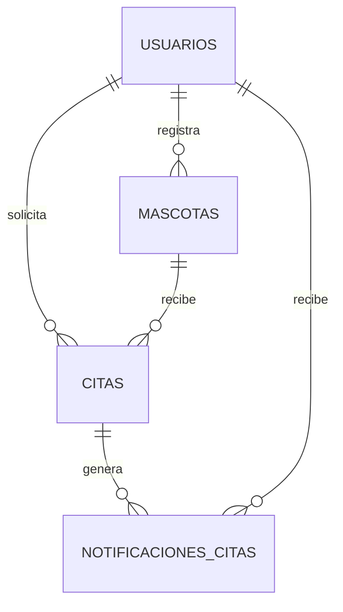

# Documentación del proyecto: Cuidado de tus Mascotas

Actualizado el 23 de noviembre de 2026.

## 1. Descripción y propósito

Aplicación web académica para el registro de mascotas y la solicitud de citas veterinarias. Cada cliente gestiona el alta de sus mascotas y consulta sus solicitudes. El administrador supervisa los registros, la disponibilidad de servicios y la agenda. El inicio público incluye un video de presentación del proyecto.

## 2. Alcance

El cliente puede crear una cuenta, editar su perfil, registrar mascotas y solicitar citas. El administrador puede gestionar clientes y mascotas, activar o desactivar servicios, asignar turnos y consultar mensajes de contacto.

## 3. Tecnologías

PHP procesa los formularios y valida las sesiones por rol. PDO ejecuta consultas preparadas contra la base MariaDB de XAMPP. HTML, CSS y JavaScript construyen la interfaz, filtran listados y consultan los horarios disponibles.

## 4. Instalación en XAMPP

1. Ubica el proyecto en `C:\xampp\htdocs\Proyecto-final\registro-mascotas` e inicia **Apache** y **MySQL** en XAMPP.
2. Para una instalación nueva, importa [`db/import.sql`](../db/import.sql) desde phpMyAdmin. El script crea la base `registro_mascotas` e incluye el esquema y los datos de ejemplo.
3. Si ya tienes una base con el módulo de citas instalado, selecciónala y aplica [`servicios-veterinarios.sql`](../db/servicios-veterinarios.sql) y [`contrasenas-practica.sql`](../db/contrasenas-practica.sql) si aún están pendientes. Si falta el módulo de citas, ejecuta primero [`citas.sql`](../db/citas.sql) sobre la base existente.
4. Configura `includes/config.php` con los valores locales de `DB_HOST`, `DB_NAME`, `DB_USER`, `DB_PASS` y `DB_CHARSET`. Abre [el sitio local](http://localhost/Proyecto-final/registro-mascotas/index.php).
5. En una instalación nueva, puedes iniciar sesión con `admin@veterinaria.com` o `laura@example.com`. La clave inicial de ambas cuentas es `12345678`.

## 5. Flujos de uso

### Ver el video del inicio

Abre **Video** en el menú principal o desplázate hasta el bloque ubicado entre **Servicios** y **Nosotros**. El reproductor conserva el formato vertical y se amplía según el espacio de la pantalla. El video comienza sin sonido cuando entra en vista y se pausa al salir. Los controles permiten reproducir, pausar y activar el audio. Si el dispositivo tiene activada la opción de movimiento reducido, inicia la reproducción desde los controles.

### Registrar una mascota y solicitar una cita

1. Inicia sesión como cliente y abre **Mis mascotas → Registrar mascota**. Escribe nombre, especie y edad en años y meses. La raza es opcional.
2. En **Citas**, selecciona tu mascota, el servicio, una fecha, un horario disponible y el motivo de consulta. Si accedes desde **Servicios**, el servicio se selecciona automáticamente.
3. Si todavía no registraste la mascota, usa **Registrar mascota** desde **Citas**. Al guardar, el sistema vuelve a **Citas** con la mascota nueva seleccionada.
4. Consulta el estado en **Citas**. El administrador asigna y confirma el horario. El cliente puede pedir un cambio de horario para una cita confirmada que todavía no se celebre.

### Administrar servicios, citas y cuentas

- En **Administración → Servicios**, usa **Activar** o **Desactivar** para controlar qué servicios pueden elegir los clientes. El catálogo inicial contiene ocho servicios, entre ellos primera consulta, vacunación, desparasitación y seguimiento.
- En **Administración → Citas**, revisa el servicio, el motivo y el turno preferido. Desde el listado puedes asignar y confirmar el horario o rechazar la solicitud. La confirmación genera un aviso en el portal. El envío de correo depende de la configuración local.
- En **Administración → Clientes**, usa **Desactivar** y confirma la acción. El estado pasa a **Inactivo**, se bloquea el inicio de sesión y la sesión existente se revoca al acceder a una página protegida. Las mascotas y citas siguen guardadas. Filtra por **Inactivas** y pulsa **Reactivar** para devolver el acceso.

### Contraseñas en la base de práctica

Las contraseñas nuevas y las modificadas se guardan en texto plano en `usuarios.contrasena`. Las cuentas que conservan un hash anterior siguen autenticándose y pasan a texto plano cuando se cambia la contraseña. El campo `contrasena_con_hash` distingue ambos formatos. Usa datos ficticios para la práctica.

## 6. Organización de carpetas
- `admin`: pantallas de administración.
- `cliente` contiene el perfil, registro de mascotas, catálogo, citas y notificaciones.
- `assets/css`: estilos compartidos y por pantalla, todos con comentarios de sección.
- `assets/js`: comportamiento de filtros, validaciones y animaciones.
- `assets/img`: siete imágenes del inicio público.
- `includes` reúne la conexión PDO, las sesiones, los horarios y las pantallas compartidas.
- `db` contiene el esquema de instalación y las migraciones SQL.
- `docs`: bitácora, manual, resumen de avance y guía de estilos.

Consultar `organizacion-estilos.md` para la correspondencia entre CSS y páginas. Los estilos comunes se cargan primero y los específicos después. Las rutas de imágenes dentro del CSS parten de `assets/css`, por eso usan `../img/`.

## 7. JavaScript existente
| Archivo | Función |
|---|---|
| `principal.js` | Dibuja recorridos de huellas y elimina cada huella al terminar su animación |
| `video-inicio.js` | Controla la reproducción del video según la visibilidad y respeta la preferencia de movimiento reducido |
| `mascotas.js` | Filtra las tarjetas del cliente por especie y actualiza el contador |
| `admin-mascotas.js` | Filtra filas de la tabla administrativa por especie |
| `admin-clientes.js` | Busca por nombre o correo y filtra por estado de cuenta |
| `formulario-cliente.js` | Valida el formulario de clientes antes del envío |
| `cambiar-contrasena.js` | Muestra/oculta claves, compara confirmación y evita repetir la clave actual escrita |

Los scripts se conectan con `defer` para esperar a que exista el HTML. Los filtros recorren las filas que PHP ya cargó desde la base de datos.

## 8. Diseño y decisiones
- Paleta azul y morada, tarjeta de acceso translúcida y ondas SVG.
- Huellas animadas detrás del formulario, sin bloquear clics.
- Tarjeta de acceso reducida por preferencia del estudiante.
- Se retiraron las orejas decorativas de los títulos; se conservó la cola.
- Menú lateral sticky en escritorio y menú superior en celulares.
- La página activa se marca con HTML y CSS; no requiere JavaScript.
- Versiones automáticas de CSS mediante filemtime para reducir problemas de caché.
- Diferenciación de especie y raza en las mascotas de ejemplo.

## 9. Imágenes del inicio
| Archivo en assets/img | Ubicación |
|---|---|
| `su cuidado.jpeg` | Presentación principal |
| `mis mascotas.jpeg` | Tarjeta Mis mascotas |
| `unete a nuestra comunidad.jpeg` | Tarjeta Únete a nuestra comunidad |
| `area del personal.jpeg` | Tarjeta Área del personal |
| `consulta veterinaria.jpeg` | Tarjeta Consulta veterinaria |
| `atencion preventiva.jpeg` | Tarjeta Atención preventiva |
| `registro de mascotas.jpeg` | Tarjeta Registro de mascotas |

## 10. Verificaciones realizadas

En la base local se aplicó la migración de servicios y se comprobó que quedaron ocho servicios activos y que se conservaron las tres citas existentes. Una prueba temporal verificó el guardado literal de la contraseña y la autenticación con contraseñas antiguas. Otra prueba temporal comprobó la desactivación y reactivación de un cliente y la conservación de su mascota y cita. También se revisó la sintaxis de los archivos PHP modificados. En Edge se comprobó el tamaño del video y la reproducción al desplazarse en escritorio y móvil, incluida la preferencia de movimiento reducido.

## 11. Pendientes técnicos

El formulario de recuperación aún no envía enlaces ni cambia contraseñas.

## 12. Material para la entrega

La sección siguiente contiene el modelo de relaciones y el acceso al Diseñador de phpMyAdmin. La imagen del diagrama preparada para la presentación puede acompañar ese apartado.

## Actualización técnica del 9 de noviembre de 2026: Persistencia PDO, Seguridad, Borrado Lógico, Sesiones por Rol y Campo Raza

En la jornada del 9 de noviembre de 2026 se completó la implementación del backend en PHP 8.2 y MySQL (InnoDB), conectando todas las vistas mediante PDO y consultas preparadas.

### 13. Modelo de base de datos y diagrama entidad-relación

En [phpMyAdmin](http://localhost/phpmyadmin/), selecciona **registro_mascotas → Diseñador**. Si la pestaña queda fuera de la barra, revisa el menú **Más**. Para la presentación, coloca `citas` en el centro, `usuarios` y `mascotas` a la izquierda, y `notificaciones_citas` a la derecha.



| Tabla | Datos y relaciones |
|---|---|
| `usuarios` | Cuentas de administradores y clientes. El correo es único y el estado determina si la cuenta puede acceder. |
| `mascotas` | Nombre, especie, raza y edad. `usuario_id` apunta a `usuarios.id`. |
| `citas` | Solicitud, disponibilidad, horario confirmado y estado. `usuario_id` apunta a `usuarios.id` y `mascota_id` a `mascotas.id`. |
| `notificaciones_citas` | Avisos y estado del correo. `cita_id` apunta a `citas.id` y `usuario_id` a `usuarios.id`. |
| `servicios_veterinarios` | Catálogo de servicios y disponibilidad. Cada cita conserva el nombre elegido como texto en `servicio_nombre`. Por eso estas tablas aparecen sin una línea entre ellas en el Diseñador. |
| `agenda_citas` | Guarda la fila que se bloquea durante la confirmación de turnos para coordinar solicitudes simultáneas. |
| `mensajes_contacto` | Guarda los mensajes enviados desde el formulario público. |

### 14. Persistencia con PDO y Aislamiento de Credenciales

- **Aislamiento de credenciales (`includes/config.php` y `.gitignore`):**
  - Las constantes `DB_HOST`, `DB_NAME`, `DB_USER`, `DB_PASS` y `DB_CHARSET` residen en `includes/config.php` protegidas con guardias `defined(...) || define(...)`.
  - El archivo `includes/config.php` está listado en `.gitignore` para evitar exponer credenciales en repositorios públicos.
- **Conexión segura (`includes/conexion.php`):**
  - Instancia `$pdo` con `PDO::ATTR_ERRMODE => PDO::ERRMODE_EXCEPTION`, `PDO::ATTR_DEFAULT_FETCH_MODE => PDO::FETCH_ASSOC` y `PDO::ATTR_EMULATE_PREPARES => false` (consultas preparadas nativas en MySQL).
  - En caso de fallo de conexión, captura `PDOException`, registra el detalle técnico con `error_log()` sin exponer trazas ni contraseñas en pantalla y define `$errorConexion` para que la interfaz muestre un aviso controlado.
- **Consultas preparadas y relaciones SQL:**
  - Todas las lecturas y escrituras con datos externos emplean `$pdo->prepare()` y marcadores con nombre (`:nombre`, `:especie`, `:raza`, `:edad_anios`, `:edad_meses`, `:usuario_id`, `:id`).
  - `admin/mascotas.php` y `admin/panel.php` utilizan `INNER JOIN` entre `mascotas` y `usuarios` para obtener el nombre del dueño junto a los datos de cada mascota activa.
  - `admin/clientes.php` emplea `LEFT JOIN` con `COUNT(mascotas.id)` y `GROUP BY` para calcular en una sola consulta cuántas mascotas activas tiene cada cliente.

### 15. Borrado Lógico (Soft Delete) e Integridad de Operaciones

- **Columna `estado`:** Tanto `usuarios` como `mascotas` cuentan con `estado ENUM('Activo', 'Inactivo') NOT NULL DEFAULT 'Activo'`.
- **Baja sin pérdida de historial:** Al eliminar una mascota desde `admin/mascotas.php` (mediante petición `POST`), no se ejecuta `DELETE FROM`, sino:
  ```sql
  UPDATE mascotas SET estado = 'Inactivo' WHERE id = :id AND estado = 'Activo'
  ```
  Se comprueba `$stmtEliminar->rowCount() > 0` antes de confirmar la baja con `?eliminado=1`.
- **Filtrado consistente y validación previa en edición:**
  - Todos los listados (`admin/mascotas.php`, `admin/clientes.php`, `admin/panel.php`, `cliente/panel.php`, `cliente/mis-mascotas.php`) y el selector de clientes en `admin/formulario-mascota.php` filtran por `estado = 'Activo'`.
  - Antes de procesar un `UPDATE` en `admin/formulario-mascota.php` o `admin/formulario-cliente.php`, el servidor verifica mediante una consulta previa que el ID recibido exista y tenga `estado = 'Activo'`, impidiendo ediciones sobre registros dados de baja o inexistentes.

### 16. Autenticación y Sesiones Estrictas por Rol

- **Inicio de sesión (`login.php`) y Registro (`registro.php`):**
  - `login.php` consulta el usuario activo por correo, valida la clave con `password_verify()`, regenera el identificador de sesión con `session_regenerate_id(true)` para prevenir fijación de sesión y almacena `usuario_id`, `usuario_nombre`, `usuario_correo` y `usuario_rol` en `$_SESSION`.
  - Redirige automáticamente a `admin/panel.php` si el rol es `admin`, o a `cliente/panel.php` si es `cliente`.
- **Middleware de protección (`includes/sesion.php`):**
  - La función `requerirRol($rolRequerido, $rutaLogin)` se invoca al inicio de todos los archivos de `admin/` y `cliente/`.
  - Declara `global $pdo, $errorConexion;` antes de incluir `includes/conexion.php` (garantizando que `$pdo` permanezca disponible en el ámbito global de la página) y consulta en tiempo real en MySQL que el `$_SESSION['usuario_id']` exista, tenga `estado = 'Activo'` y posea exactamente el rol requerido.
  - Si alguna comprobación falla, invoca `destruirSesionYRedirigir()`, que limpia `$_SESSION`, destruye la sesión y redirige a `login.php`.
- **Seguridad en Perfil (`cliente/perfil.php`), Cambio de Contraseña (`cambiar-contrasena.php`) y Cierre (`logout.php`):**
  - `cliente/perfil.php` y `cambiar-contrasena.php` operan exclusivamente sobre `$_SESSION['usuario_id']`, sin utilizar jamás un cliente por defecto.
  - `logout.php` (y `cerrar-sesion.php`) vacía `$_SESSION`, expira la cookie de sesión en el navegador, ejecuta `session_destroy()` y redirige a `login.php`.

### 17. Integración del Campo `raza` y Edad Detallada (`edad_anios` y `edad_meses`)

- **Esquema y comando SQL para `raza`:**
  - La tabla `mascotas` incorpora la columna `raza`:
    ```sql
    ALTER TABLE mascotas ADD COLUMN IF NOT EXISTS raza VARCHAR(100) NOT NULL DEFAULT 'No especificada' AFTER especie;
    ```
- **Captura y persistencia en `admin/formulario-mascota.php`:**
  - Se añadió el campo de texto `<input type="text" id="raza" name="raza" maxlength="100" required>` dentro de su contenedor `.campo-admin` para que el administrador digite manualmente la raza al registrar o editar una mascota.
  - El procesamiento `POST` en PHP sanea y valida `$_POST['raza']` (obligatorio, hasta 100 caracteres) y lo vincula mediante el parámetro preparado `:raza` tanto en `INSERT INTO mascotas` como en `UPDATE mascotas`.
  - La edad se captura en dos campos numéricos (`edad_anios` de `0` a `100` y `edad_meses` de `0` a `11`) y se formatea de manera uniforme con `formatearEdad($anios, $meses)` desde `includes/formato.php`.
- **Visualización dinámica en paneles:**
  - `admin/mascotas.php` selecciona `mascotas.raza` en el `INNER JOIN` y la imprime en su propia columna `<td>` dentro de la tabla administrativa.
  - `cliente/panel.php` y `cliente/mis-mascotas.php` consultan `raza` en la tabla `mascotas` e imprimen dinámicamente `<dt>Raza</dt><dd><?= htmlspecialchars($razaTexto, ENT_QUOTES, 'UTF-8') ?></dd>` en cada tarjeta.

### 18. Estado de Pantallas y Cuentas de Prueba (9 de noviembre de 2026)

- **Ejecución local:** Disponible tanto en Apache (`http://localhost/Proyecto-final/registro-mascotas/index.php`) como en el servidor interno de PHP (`http://localhost:8000/index.php`).
- **Cuentas de prueba en `db/import.sql`:**
  - **Administrador:** `admin@veterinaria.com` | Contraseña: `12345678`
  - **Cliente:** `laura@example.com` | Contraseña: `12345678` (con las mascotas *Max* — Perro, Golden Retriever — y *Luna* — Gato, Siamés —).

---

## Actualización técnica del 17 de noviembre de 2026: Bandeja de Mensajes y Respuesta en Gmail

### 19. Bandeja Administrativa de Mensajes (`admin/mensajes.php`)

Para evitar que el personal administrativo dependa de phpMyAdmin o acceso directo a MySQL para revisar las consultas enviadas desde `contacto.php`, se incorporó el módulo `admin/mensajes.php` integrado en la barra lateral de todo `admin/` y en los accesos rápidos de `admin/panel.php`:

- **Protección RBAC:** Exige sesión activa con rol `admin` mediante `requerirRol('admin', '../login.php')` antes de cualquier salida HTML.
- **Consulta ordenada:** Recupera `id, nombre, correo, asunto, mensaje, creado_en` de `mensajes_contacto` con `ORDER BY creado_en DESC, id DESC`, mostrando las consultas más recientes primero.
- **Redirección directa a Gmail (`construirUrlGmail()`):**
  - Cada registro incluye un enlace **`Responder en Gmail ↗`** apuntando a `https://mail.google.com/mail/?view=cm&fs=1` con los parámetros `to`, `su` (`Re: <asunto>`) y `body` (saludo personalizado) codificados con `rawurlencode()`.
  - Además, la cabecera ofrece un acceso directo **`Abrir Gmail ↗`** (`https://mail.google.com/`).
  - Ambos enlaces utilizan `target="_blank" rel="noopener noreferrer"` para abrir Gmail en una pestaña nueva sin perder la sesión del panel ni exponer `window.opener`.
- **Lectura en ventana modal vía `data-attributes`:** La tabla muestra únicamente el **Asunto** en la vista previa; el botón **`👁 Leer mensaje`** almacena `data-nombre`, `data-correo`, `data-asunto`, `data-mensaje` y `data-gmail` para poblar `#modal-mensaje` dinámicamente mediante `textContent` sin peticiones adicionales al servidor, heredando las variables de Modo Claro y Modo Oscuro de `tema.css`.
- **Filtrado instantáneo (`assets/js/admin-mensajes.js`):** Permite buscar por nombre, correo, asunto o contenido usando normalización Unicode `NFD`.

---

## Estándares de Documentación

El código fuente del proyecto está documentado internamente en español mediante **PHPDoc** y **JSDoc** con un enfoque estricto de **concisión técnica y justificación estructural** (máximo 1 a 2 líneas por bloque), explicando el *cómo* y el *por qué* arquitectónico o de seguridad sin saturar visualmente los archivos ni alterar la lógica funcional:

- **PHPDoc (`/** ... */`) en Backend (`includes/`, `admin/`, `cliente/` y raíz):**
  - Cabeceras de nivel de archivo (`@package`, `@var`) que sintetizan en una línea la responsabilidad transaccional o de control de acceso del script.
  - Documentación de funciones (`destruirSesionYRedirigir()`, `requerirRol()`, `formatearEdad()`) con `@param` y `@return` tipados, justificando decisiones críticas como la invalidación de cookies `PHPSESSID`, la exposición de `$pdo` en el ámbito global o la verificación en caliente contra MySQL.
- **Comentarios de bloque de alta densidad técnica (`/* ... */`):**
  - Documentan en 1 línea las garantías de seguridad e integridad en cada fase del flujo: desactivación de emulación de *prepared statements* (`ATTR_EMULATE_PREPARES = false`) contra inyección SQL, rotación de `session_id` (`session_regenerate_id(true)`) contra *Session Fixation*, aislamiento por `:usuario_id` contra vulnerabilidades IDOR, patrón PRG (*Post/Redirect/Get*) y preservación referencial mediante *Soft Delete* (`estado = 'Inactivo'`).
- **JSDoc (`/** ... */`) en Frontend (`assets/js/`):**
  - Bloques concisos con `@param` y `@returns` que explican los mecanismos del DOM: sincronización de `[data-theme="dark"]` con `localStorage`, contenedor *Singleton* ARIA live y `MutationObserver` para notificaciones Toast reactivas, descomposición canónica Unicode `NFD` (`U+0300–U+036F`) para búsqueda insensible a tildes e intercepción de eventos `submit` con `preventDefault()`.
